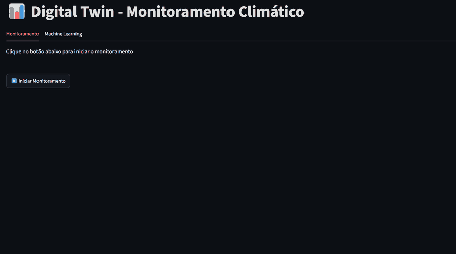
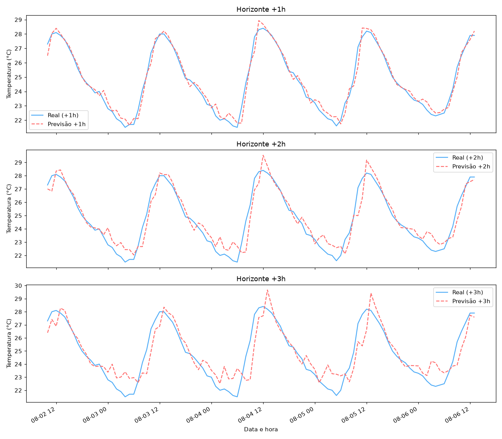
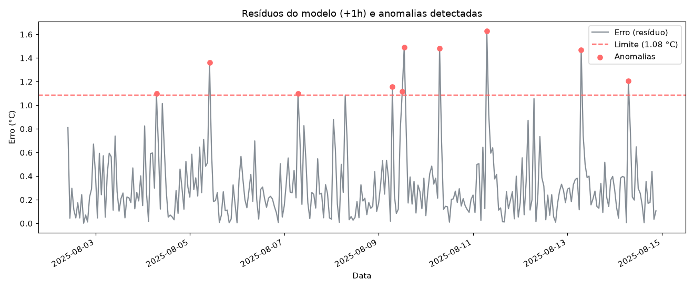
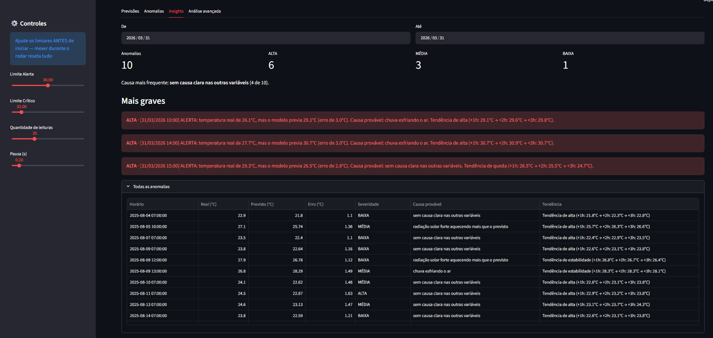

# Climate Digital Twin

> [!NOTE]
> Projeto em desenvolvimento. As funcionalidades descritas aqui já funcionam, mas ainda estou trabalhando em melhorias e novas etapas.

Gêmeo digital de um sensor climático virtual (ENV-01). Os dados horários vêm da API Open-Meteo, são tratados como leituras de sensor, classificados por temperatura e usados para prever a temperatura das próximas horas e detectar anomalias, com explicações em linguagem natural.



## O que o projeto faz

1. **Coleta** (`collector.py`): baixa o histórico da Open-Meteo e salva em `data/weather_data.csv`.
2. **Sensor virtual** (`sensor.py`): simula o envio de leituras, uma por vez.
3. **Gêmeo digital** (`twin.py`): classifica cada leitura (NORMAL, ALERTA, CRÍTICO) e mantém o histórico.
4. **Baselines** (`baseline.py`): previsão por persistência e média móvel, comparadas com uma regressão linear.
5. **Machine learning** (`ml/`): um modelo por horizonte (+1h, +2h, +3h), detecção de anomalias pelo erro do modelo e insights (o que aconteceu, causa provável, tendência e severidade).
6. **Dashboard** (`dashboard/`): monitoramento em tempo simulado e uma aba com previsões, anomalias e insights.

## Estrutura

```
Climate_digital_twin2.0/
├── data/
│   └── weather_data.csv
├── climate_twin/
│   ├── config.py        constantes compartilhadas
│   ├── data.py          leitura do CSV
│   ├── collector.py     coleta da API
│   ├── sensor.py        sensor virtual
│   ├── twin.py          gêmeo digital
│   ├── baseline.py      baselines e regressão simples
│   ├── stats.py         máximo de temperatura e leituras críticas
│   └── ml/
│       ├── features.py      features de hora e temperaturas defasadas
│       ├── model.py         treino por horizonte e comparação com o baseline
│       ├── anomalies.py     detecção e agrupamento em eventos
│       ├── insights.py      frases, causa, tendência, severidade e resumo
│       ├── exploration.py   análises por hora e comparação de detectores
│       ├── plots.py         figuras do matplotlib
│       ├── pipeline.py      treinar() e analisar()
│       └── __main__.py      saída resumida no terminal
├── dashboard/
│   ├── app.py           dashboard principal
│   └── ml_tab.py        aba de machine learning
├── docs/images/         imagens usadas neste README
├── LICENSE
├── README.md
└── requirements.txt
```

A lógica em `climate_twin/ml/` não imprime nem desenha nada: devolve dados e figuras. O terminal e o dashboard são duas formas de exibir o mesmo resultado.

## Como rodar

Requer Python 3.11 ou superior (exigência do pandas 3); testado com Python 3.14. Execute todos os comandos a partir da raiz do projeto.

```bash
pip install -r requirements.txt

python -m climate_twin.collector          # baixa os dados (opcional, o CSV já vem no repositório)
python -m climate_twin.sensor             # sensor virtual
python -m climate_twin.twin               # gêmeo digital
python -m climate_twin.baseline           # baselines e regressão simples
python -m climate_twin.stats              # máximo de temperatura

python -m climate_twin.ml                 # resumo do dia com mais anomalias
python -m climate_twin.ml --dia 2026-03-31
python -m climate_twin.ml --graficos      # abre também os gráficos

streamlit run dashboard/app.py            # dashboard
```

## Resultados

Erro médio absoluto no conjunto de teste (últimos 20% da série, cerca de 10 mil horas), comparado com o baseline de persistência (a temperatura futura é igual à atual):

| Horizonte | Modelo | Baseline |
|-----------|--------|----------|
| +1h       | 0,36 °C | 0,53 °C |
| +2h       | 0,66 °C | 0,98 °C |
| +3h       | 0,91 °C | 1,40 °C |



Uma anomalia é um erro do modelo +1h acima do limite (média + 2 desvios padrão dos resíduos):



Cada anomalia vira um insight com severidade, causa provável e tendência:



## Decisões e limitações

- A divisão treino/teste é cronológica, para o modelo não ver o futuro durante o treino.
- Os horários exibidos nos insights são o horário alvo, isto é, a hora a que a temperatura prevista se refere (leitura + h).
- Anomalia significa que o modelo errou muito, não que o clima foi extremo. Um modelo fraco gera falsas anomalias.
- O limite global é calculado sobre os mesmos resíduos que ele julga. O detector calibrado no treino evita isso.
- A regressão linear é simples e a hora do dia entra como número comum (23 e 0 ficam distantes).
- As regras de causa provável são heurísticas, com limites escolhidos à mão em `config.py`. Indicam uma causa provável, não provam causalidade. As regras olham as condições do horário alvo (o da anomalia), não as da leitura.

## Próximos passos

1. **Simulação What-If**: permitir que o usuário altere variáveis do estado atual (temperatura, umidade, vento, radiação solar) e observe o estado futuro previsto. É o coração do gêmeo digital: experimentar cenários.

   `Estado atual + mudanças What-If → modelo preditivo → estado futuro → análise de impacto`

2. **Recomendações automáticas**: sugerir ações a partir do estado, da previsão e dos cenários What-If. Exemplo: "Com menor ventilação, a temperatura prevista aumenta. Considere aumentar a ventilação artificial."

   `Estado → previsão → What-If → recomendação`

## Licença e créditos

O código está sob a licença MIT; veja o arquivo [LICENSE](LICENSE).

Dados meteorológicos: [Open-Meteo](https://open-meteo.com/), licenciados sob [CC BY 4.0](https://creativecommons.org/licenses/by/4.0/).
